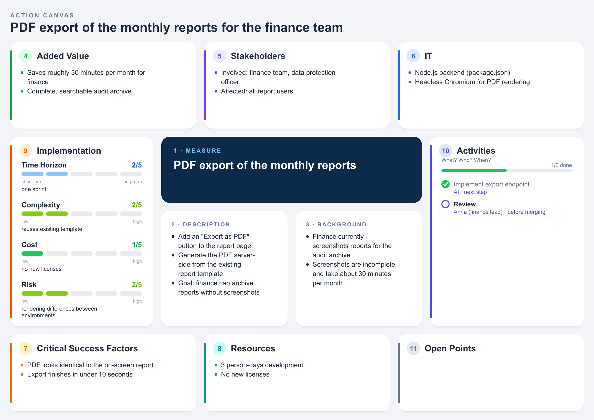

# action-canvas

[](https://skills.sh/tobiashofmann/action-canvas)
[](LICENSE)

An [Agent Skill](https://docs.claude.com/en/docs/claude-code/skills) that keeps a one-page **action canvas** for every feature branch, so the requester can always see **what** is being done, **why**, and **with what impact**.

The agent creates the canvas when a feature branch starts, plans it, keeps it current while it works, and finalizes it before the PR. Each canvas is a Markdown file plus a rendered SVG/PNG image.



## What it does

- Creates `docs/action-canvas/<branch-slug>.md` with 11 fields: measure, description, background, added value, stakeholders, IT, critical success factors, resources, implementation (time horizon, complexity, cost, risk on a 1–5 scale), required activities, open points.
- Asks the requester when something is not the AI's to decide, instead of guessing.
- Fills IT resources only when the repo clearly shows them, and asks otherwise.
- Writes the canvas, the image and its chat messages in the requester's language: English, German, Portuguese, French, Italian or Spanish.
- Renders the canvas as a one-page card layout (long title on top, short measure name in the highlighted box) with a dependency-free Python script and validates required fields per phase (`start`, `plan`, `final`).

## Install

```bash
npx skills add tobiashofmann/action-canvas
```

Only the `skills/action-canvas/` folder (`SKILL.md` and `render_canvas.py`) is installed; examples and tests stay in the repo.

Or copy `skills/action-canvas` to `~/.claude/skills/action-canvas` (personal) or `<project>/.claude/skills/action-canvas` (per project).

## Requirements

- Python 3 (standard library only).
- Optional, for PNG output: `pip install cairosvg` or `rsvg-convert`.

## Usage

Start a feature branch and describe the feature. The skill triggers on its own. You can also run the renderer directly (in an installed skill the script sits next to `SKILL.md`, e.g. `.claude/skills/action-canvas/render_canvas.py`):

```bash
python3 skills/action-canvas/render_canvas.py docs/action-canvas/feature-x.md --check plan
python3 skills/action-canvas/render_canvas.py docs/action-canvas/feature-x.md --png
python3 skills/action-canvas/render_canvas.py docs/action-canvas/feature-x.md --lang de   # force a language
```

Examples: [English](examples/feature-pdf-export.md), [German](examples/feature-pdf-export.de.md).

## Tests

```bash
python3 -m unittest discover -s tests -v
```

Smoke tests for the renderer (standard library only): examples pass the checks, missing fields fail, localized messages, Implementation warnings, truncation, escaping.

## License

[Apache License 2.0](LICENSE)
