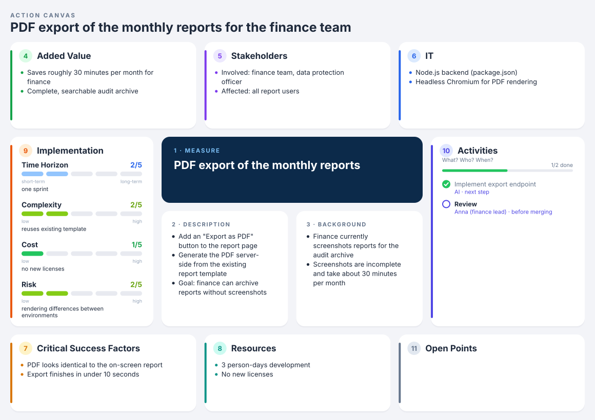

# PDF export of the monthly reports for the finance team

<!-- canvas-meta: branch=feature/pdf-export; lang=en; phase=final; created=2026-11-20; updated=2026-11-20 -->

## Measure
- PDF export of the monthly reports

## Description
- Add an "Export as PDF" button to the report page
- Generate the PDF server-side from the existing report template
- Goal: finance can archive reports without screenshots

## Background
- Finance currently screenshots reports for the audit archive
- Screenshots are incomplete and take about 30 minutes per month

## Added Value
- Saves roughly 30 minutes per month for finance
- Complete, searchable audit archive

## Stakeholders
- Involved: finance team, data protection officer
- Affected: all report users

## IT
- Node.js backend (package.json)
- Headless Chromium for PDF rendering

## Critical Success Factors
- PDF looks identical to the on-screen report
- Export finishes in under 10 seconds

## Resources
- 3 person-days development
- No new licenses

## Implementation
- Time Horizon: 2/5 – one sprint
- Complexity: 2/5 – reuses existing template
- Cost: 1/5 – no new licenses
- Risk: 2/5 – rendering differences between environments

## Required Activities for Implementation
- [x] Implement export endpoint — AI — next step
- [ ] Review — Anna (finance lead) — before merging

## Open Points
- 
